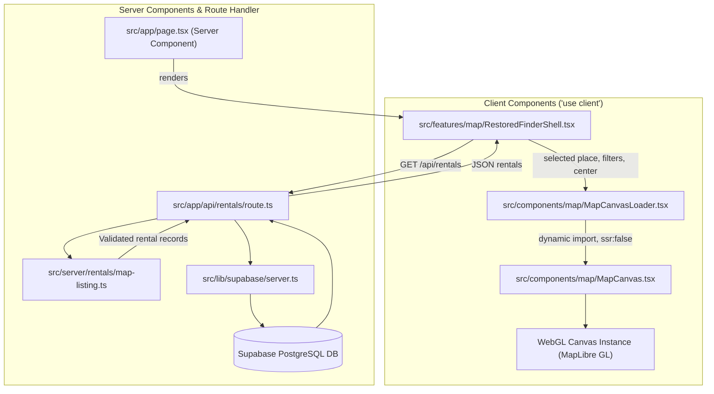

# Client vs. Server Component Boundaries & MapLibre Integration

## 1. Fundamentals: React Server Components (RSC) in Next.js 16
Next.js 16 uses the App Router where all components are Server Components by default.

| Dimension | Server Component (Default) | Client Component (`'use client'`) |
| :--- | :--- | :--- |
| **Execution** | Server Components run in the configured server runtime; Route Handlers use Node.js by default unless configured otherwise | Pre-rendered to HTML on server, hydrated in browser |
| **Data Access** | Query through server integrations/Route Handlers; keep privileged keys server-side | Read serialized props, call Route Handlers or Server Actions, or use browser SDK |
| **Browser APIs** | ❌ No `window`, `document`, WebGL, or localStorage | ✅ Full access to DOM, canvas, and browser events |
| **React Hooks** | ❌ No `useState`, `useEffect`, `useRef` | ✅ All standard React hooks supported |
| **Client Bundle**| No Server Component JavaScript is shipped for that component; it may still serialize rendered output | Adds component code to browser JS bundle |

---

## 2. The MapLibre GL WebGL Boundary Challenge

### The Problem
`maplibre-gl` is tightly coupled to browser DOM and GPU APIs:
- Accesses `window` and `document` at module evaluation time.
- Requires `HTMLCanvasElement` and WebGL context (`gl.getContext('webgl2')`).

If imported directly into an RSC or during standard SSR pre-rendering:
```text
ReferenceError: window is not defined
    at Object.<anonymous> (node_modules/maplibre-gl/dist/maplibre-gl.js:...)
```

### The Architectural Solution
1. **Dynamic Client Quarantine (`next/dynamic`)**:
   Wrap the map component in a dynamic loader configured with `{ ssr: false }`. Next.js skips server-side evaluation entirely and only mounts the component once the client DOM is ready.
2. **Rental Data Request**:
   The Server Component renders the client finder shell. The shell requests `GET /api/rentals`; the Route Handler reads published rentals through the server Supabase client, maps and validates records, and returns serialized rental data. The API response is fetched with `cache: "no-store"`; it is not passed from the page as props.



---

## 3. WebGL Lifecycle & Preventing Memory Leaks
WebGL contexts are limited system resources managed by the GPU. In a Single Page App (SPA), navigating away from a map page without cleaning up the MapLibre instance causes **WebGL context leaks** (eventually throwing `WARNING: Too many active WebGL contexts. Oldest context will be lost`).

### Implementation Pattern:
```tsx
'use client';

import { useEffect, useRef } from 'react';
import maplibregl from 'maplibre-gl';
import 'maplibre-gl/dist/maplibre-gl.css';

export function MapContainer() {
  const mapContainerRef = useRef<HTMLDivElement>(null);
  const mapRef = useRef<maplibregl.Map | null>(null);

  useEffect(() => {
    if (!mapContainerRef.current) return;

    // 1. Initialize instance
    const map = new maplibregl.Map({
      container: mapContainerRef.current,
      style: 'https://basemaps.cartocdn.com/gl/positron-gl-style/style.json',
      center: [123.8854, 10.3157], // Cebu City
      zoom: 12,
    });

    mapRef.current = map;

    // 2. CRITICAL CLEANUP: Always remove the map on unmount
    return () => {
      map.remove();
      mapRef.current = null;
    };
  }, []);

  return <div ref={mapContainerRef} className="h-full w-full min-h-[500px]" />;
}
```

---

## 4. Boundaries for Supabase Operations
- **Data Fetching**: Use the server client in Server Components, Server Actions, and Route Handlers to keep privileged access and queries off the client bundle. Using the server client does not automatically cache Supabase query results; configure caching explicitly only when the route and data allow it.
- **Client Interactions (Realtime / Auth triggers)**: Use `src/lib/supabase/client.ts` inside Client Components (`'use client'`).

---

## 5. OpenStreetMap (OSM) Integration
AbangCebuAI uses **OpenStreetMap** as its primary geographic data foundation. MapLibre GL is the rendering engine that visualizes OpenStreetMap data.

### Standard Configuration: OpenFreeMap Liberty Style
The map style uses the hosted OpenFreeMap Liberty style with versioned vector tiles and OpenStreetMap-derived data. No API key is required. The style specification is maintained locally at [`public/styles/osm.json`](../../public/styles/osm.json); required provider attribution is included in the style's vector source.

Developers building map components can point the map style to the local endpoint:
```tsx
const map = new Map({
  container: mapContainerRef.current,
  style: process.env.NEXT_PUBLIC_MAP_STYLE_URL || '/styles/osm.json',
  center: [123.8854, 10.3157], // Cebu City Center
  zoom: 12,
});
```

